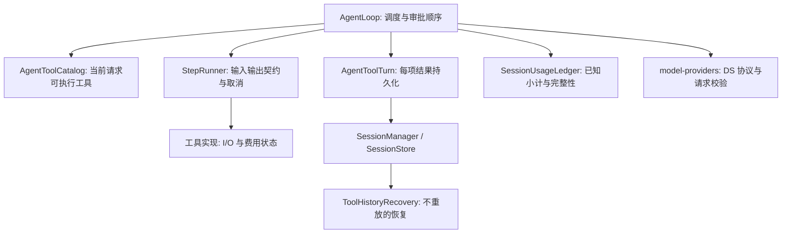

# Orbit Harness 架构审查（2026-11-17）

后续状态：本记录中的 Zod 与本机 Node 安全问题已经在[同日后续优化](HARNESS_SECURITY_FOLLOWUP_2026-11-17.md)中关闭。以下保留初轮审查证据，最新验证与边界以该后续记录为准。

本轮基于本地工作区（Git 基线 `160c10a`，包含此前未提交的优化）审查执行循环、权限、取消、会话恢复、上下文压缩、费用记录和 DeepSeek 模型边界。保留此前修改，没有提交、推送或发布新版本。

## 判断

Orbit 已有清晰的包依赖方向、模型协议适配、工作区保护、检查点、验证门禁和离线代理测试基础。主要薄弱点在跨模块状态交接：展示给模型的工具权限与执行权限不一致，工具结果延迟持久化，费用完整性与费用数值混用。继续堆叠功能无法解决这些问题。

本轮按独立状态责任拆出工具准入、工具回合持久化、费用账本；保留主循环中的审批、编辑验收和验证顺序。目标是让关键保证可以单独验证，避免为了缩短文件而移动耦合代码。

## 官方对照基线

本轮实际取得的 [DeepSeek Harness 提交](https://github.com/deepseek-ai/deepseek-harness/commit/39163dd30f703a79079e2d2446545cff3c453738) 为 `39163dd30f703a79079e2d2446545cff3c453738`，提交日期 2026-11-13，版本同步 `0.2.2-rc.3`。此前 10 月基线不能代表当前实现。

参考的具体边界：

- [请求构建](https://github.com/deepseek-ai/deepseek-harness/blob/39163dd30f703a79079e2d2446545cff3c453738/packages/core/agent-loop/src/agent.ts)：请求配置、工具表、会话投影在准入后形成明确快照。
- [工具配对](https://github.com/deepseek-ai/deepseek-harness/blob/39163dd30f703a79079e2d2446545cff3c453738/packages/compaction/compaction/src/tool-pairing.ts)：压缩边界依据工具调用和结果的配对关系。
- [模型能力](https://github.com/deepseek-ai/deepseek-harness/blob/39163dd30f703a79079e2d2446545cff3c453738/packages/llm/llm-deepseek/src/model-info.ts)：模型目录与每次操作的有效能力分开。
- [图片请求状态](https://github.com/deepseek-ai/deepseek-harness/blob/39163dd30f703a79079e2d2446545cff3c453738/packages/llm/llm-deepseek/src/request-files.ts)：文件引用恢复有单次请求范围和重试边界。
- [图片预算](https://github.com/deepseek-ai/deepseek-harness/blob/39163dd30f703a79079e2d2446545cff3c453738/packages/llm/llm-deepseek/src/request-pricing.ts)：图片尺寸投影、请求体积和 token 预算共享模型能力。
- [官方思考模式说明](https://api-docs.deepseek.com/guides/thinking_mode/)：继续遵守 Flash/Pro 采样差异和工具会话的 reasoning 回传要求。

借鉴边界设计，没有复制官方实现代码。本轮不切换默认协议，不启用增量工具协议，也不自动开启收费 Search/Fetch 或 Files。

## 已修复问题

| 优先级 | 已确认的问题                                                         | 本轮处理                                                                                                   |
| ------ | -------------------------------------------------------------------- | ---------------------------------------------------------------------------------------------------------- |
| P1     | 禁用工具、角色 allow/deny 只过滤模型列表，执行时仍可从注册表调用     | `AgentToolCatalog` 为每个请求保存准入集合；串行、并行和 XML 回退统一检查；拒绝生成期间或审批后被替换的工具 |
| P1     | 工具结果整批结束才保存，取消会丢失已完成结果和工具配对               | `AgentToolTurn` 逐项持久化；退出时仅为未记录结果补充中断说明，禁止暗示成功或自动重放                       |
| P1     | 旧版本正常取消的会话不会修复未配对调用；跨轮复用 ID 会漏修复         | `ToolHistoryRecovery` 按会话顺序修复每个交换边界，并覆盖 aborted/failed 等已有会话                         |
| P1     | 不确定费用会关闭预算检查，后续已知费用不落盘                         | `SessionUsageLedger` 分离已知小计与完整性；恢复后保留小计，预算达到上限即检查；压缩前先检查预算            |
| P1     | 取消竞态丢失收费工具的费用状态；后置 Hook 失败可覆盖原结果中的费用   | 工具在发请求前报告费用状态；执行边界保留该状态；主循环在中断和后置 Hook 前记账；并行路径共用入口           |
| P2     | 请求执行微任务开始前取消仍可能启动工具；超时变更工具被统一标为可重试 | 真正执行前再次检查取消；已启动的非幂等操作超时后不标为可安全重试                                           |
| P2     | 未配置缓存单价时缓存输入被当成免费                                   | 缺少专用缓存单价时按普通输入价计入估算；明确的零价格仍被尊重                                               |
| P2     | 摘要流没有正常结束也可能覆盖可靠的机械摘要                           | 只接受有完成事件、未取消且有长度上限的摘要；失败保留机械摘要                                               |
| P2     | Files 路径先上传图片，再发现历史或参数无效                           | 三种协议上传前先验证工具历史、工具定义、用户标识、思考工具选择和公共参数                                   |

## 当前责任边界

新增模块的构造过程不做 I/O。工具结果与费用使用现有会话格式，旧会话无需批量迁移。未改变密钥存储方式。

## 验证记录

本轮最终结果：

- `pnpm verify`：依赖声明、架构、文档、ESLint、Prettier、全包构建、生产/测试 TypeScript、Skills 校验及完整测试通过。Vitest **300 文件，2220 通过、2 跳过**；Skills Python 测试 24 项，1 项跳过。
- 最后一次准入边界调整后，补跑相关用例、ESLint、格式与生产/测试类型检查；全局安装流程重新构建当前源码并通过。
- `node scripts/smoke-cli.mjs`、`node scripts/smoke-installed-cli.mjs`、`node scripts/verify-cli-package.mjs`：通过。覆盖文本 REPL、执行退出码、JSONL、LSP、独立安装/卸载及包内容。
- `node scripts/verify-runtime-budgets.mjs`：通过；热文件系统下进程启动中位数约 260 ms。此数字是本机抽样，不是模型首字延迟或跨平台基准。
- `pnpm notices:check`、`git diff --check`：通过。
- `pnpm audit:prod`：**仍失败，剩余 1 项 Zod 高风险公告**，详情见下节。
- 本轮没有重新消耗 API 额度运行真实模型任务评测，也没有更改 WebUI 页面或重跑浏览器端到端测试。

用例覆盖：禁用工具的单次/并行调用、工具被替换、逐项保存后取消、旧 aborted 会话恢复、跨轮同 ID、未知费用后的预算与恢复、收费取消、非幂等超时、三种 DS 协议上传前拒绝非法历史、摘要流异常。

已有三个测试原先在关闭 bash 工具的情况下仍要求执行 run_tests，这实际依赖上述权限漏洞。测试已显式启用其需要的执行工具，保留原有验收断言。

## 依赖与本机运行时审计

- 生产依赖 `undici` 从本轮开始时的 `6.28.1` 更新至同主版本的 `6.29.1`，锁文件与许可证清单同步更新。对应 [响应编码拒绝服务](https://github.com/advisories/GHSA-xjj6-f33q-929c)、[TLS 回调丢失](https://github.com/advisories/GHSA-2m5v-pch6-74hx)、[TLS 重协商拒绝服务](https://github.com/advisories/GHSA-qrxm-fqhp-jwvm) 的包级公告。
- **仍未关闭：Zod 高风险公告。** 当前使用 `zod@3.25.76`；[公告](https://github.com/advisories/GHSA-mrhx-c7xc-m3w5) 的修复版本为 `4.6.6`。[上游修复](https://github.com/colinhacks/zod/commit/a0ebf970f2d752e5f58527cd2942ff48be4f46bd) 修改 v4 集合解析路径，并没有为现用 v3 提供直接兼容补丁。Orbit 的类型契约及 `zod-to-json-schema` 仍使用 v3，需要整体迁移并验证模型工具 Schema；不能仅改版本号或忽略公告后宣称修复。
- **仍未关闭：本机 Node 内置网络库。** 实测 Node `v26.10.0` 内置 Undici `8.10.2`，位于上述公告受影响区间。项目 npm 依赖升级不会替换 Node 内置的全局 `fetch`。本轮没有更换整个电脑的 Node；需升级至包含安全修复的 Node 版本，再复验 API 与网络工具。当前 [Node 官方下载页](https://nodejs.org/en/download/current) 提供 `v26.13.1` LTS，实际安装后仍应检查内置 Undici 版本。

依赖安全门禁保留失败状态，没有增加忽略规则。本轮本地构建可用于验证改进，不能据此认定已经满足正式发布门禁。

## 本地交付

- 已重新构建并安装独立全局包 `@orbit-build/cli@1.9.4`，终端入口 `/opt/homebrew/bin/orbit`；版本号保持不变，没有 npm 发布。
- `orbit --version` 返回 `1.9.4`，安装后的 `dist/index.js` 与当前工作区构建逐字节一致。
- 安装包校验：36 个文件，压缩后 2,671,574 字节；独立安装/启动/卸载检查通过。
- 更新前安装包保存在 `output/local-deployment/rollback-2026-11-17/orbit-build-cli-1.9.4.tgz`。
- 已运行的 Orbit/WebUI 进程不会自动加载新代码，重新启动 Orbit 后生效。

## 距离顶级 Harness 仍需推进

1. **可重复的真实任务评测。** 建立固定代码任务、错误注入和长会话恢复集，比较成功率、费用、耗时、无效工具次数。协议连通与大量单测不能代替真实任务质量评估。
2. **统一请求预算投影。** 官方已将图片缩放、每张图片 token 和实际请求体预算关联。Orbit 仍有保守固定图片估算，模型能力常量也保留安全余量；后续应由提供商投影能力统一驱动，而非在 core 中硬编码 DS 公式。
3. **增量上下文协议。** system-in-history、addition-only 工具表需要持久化协议、模型切换和网关回退的完整测试。本轮保留稳定全量工具表，避免为了缓存命中率破坏恢复语义。
4. **隔离不合作的扩展。** 取消边界可停止等待并拒绝迟到结果，不能终止任意进程内第三方代码。变更类扩展应逐步进入独立进程或工作区事务；本轮没有宣称任意工具收到 abort 后绝不会继续写文件。
5. **更强的费用预留。** 当前预算检查约束已知费用，不等价于提供商硬消费上限。已经在途的请求和本批次费用可能超过预算；未来需要跨模型、工具、子任务的预留与结算机制。
6. **继续拆分编辑事务。** 主循环仍承担审批、检查点、差异验收、验证和提交协调。下一步应以完整编辑事务为边界提取，配套失败注入，而不是全面重写主循环。

以上是后续工程方向；本轮不将这些尚未完成的能力计入交付，也不据此声称已经达到顶级水平。
